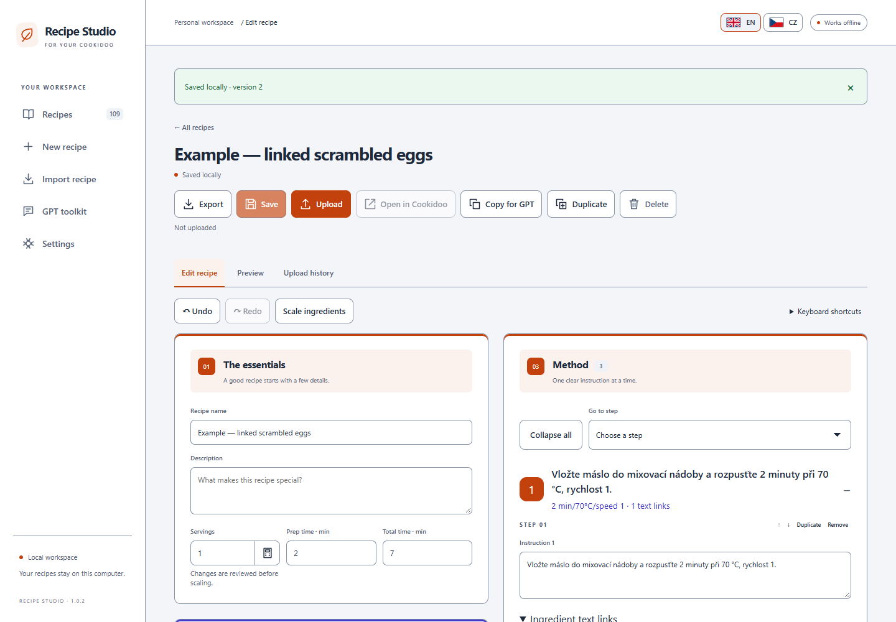
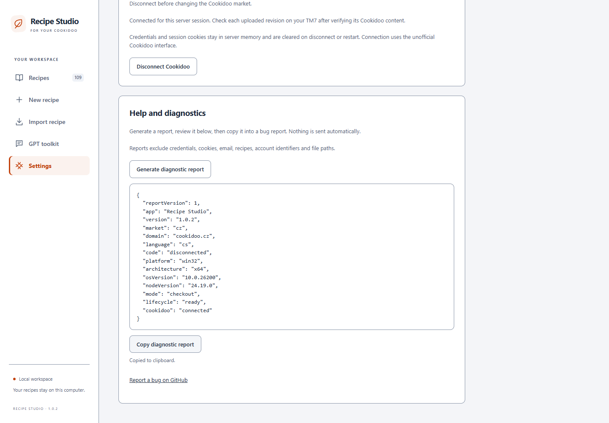

# Recipe Studio

Prepare your own recipes, link ingredients to instructions, and upload them to Cookidoo for your Thermomix TM7.

An independent hobby project by **kafeee80**. Not affiliated with or endorsed by Vorwerk. Cookidoo and Thermomix are trademarks of their respective owners.

## Public beta preparation

**There is no publicly downloadable beta yet.** The Windows candidate is being checked before publication. An unpublished draft release is visible only to repository maintainers. This repository contains documentation and issue templates, not application source. GitHub's “Source code” ZIP is not the application.

When available, installers will appear under [Releases](https://github.com/kafeee80/CookidooRecipeStudioPublic/releases). Download only the named RecipeStudio-Setup-<version>.exe asset and its SHA256SUMS.txt. The initial beta is intended to be free for personal use with no expiry; [draft terms](BETA-TERMS.md) are awaiting release approval.

## What it does

- Local browser editor with EN/CZ interface, ingredient links and Thermomix controls.
- JSON import/export and GPT prompts for converting your own recipes. No built-in AI service or ChatGPT account integration.
- One Upload/Update action with checking, Cookidoo read-back verification and upload recovery history.
- Windows tray controls, optional quiet sign-in startup and upgrades that preserve saved recipes.
- Twenty selectable Cookidoo markets; **only the Czech market has user-reported live upload and TM7 UI acceptance**. The others are experimental.

## Start here

[Install, stop, upgrade and uninstall](INSTALL.md) · [Supported controls and known limits](KNOWN-LIMITS.md) · [Markets](MARKETS.md) · [Privacy](PRIVACY.md) · [Reporting bugs](SUPPORT.md) · [Changelog](CHANGELOG.md)

Windows x64 is the packaging target. The installer requires Windows 10 build 17763 or newer; that technical minimum is not a claim that every Windows edition/build has been tested. Clean-VM and second-account acceptance remain pending. No Node, Git, terminal or administrator rights are required for the default per-user install.

A matching Cookidoo account with Created Recipes access and an internet connection are needed for uploads. Review the recipe and controls on your TM7 before cooking. Verification confirms returned Cookidoo content, not cooking safety or results.
